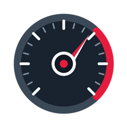
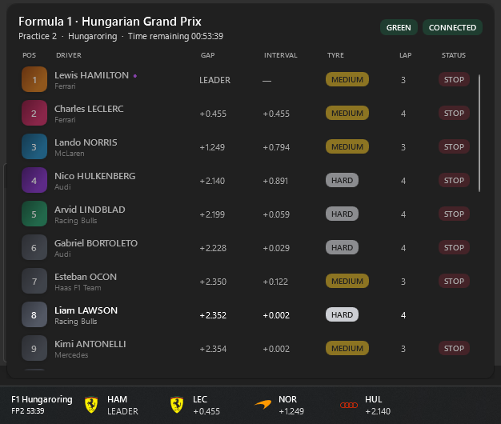

# RaceDock

**Live motorsport timing and upcoming race schedules, right on your Windows taskbar.**

[Microsoft Store](https://apps.microsoft.com/detail/9pcxqvr2g106) ·
[Portable download](https://github.com/Foxtrot47/RaceDock/releases/latest) ·
[Contribute](CONTRIBUTING.md) ·
[Changelog](CHANGELOG.md) ·
[Privacy](PRIVACY.md)

RaceDock puts live race timing in your Windows taskbar, so you can follow a session while you work.
The leaders stay visible in a small strip on the taskbar. Click it and the full classification opens without pulling focus away from whatever you are using. Between sessions the strip shrinks to the next session on the calendar and counts down to it; click then to see the upcoming schedule. The countdown can be turned off in Settings, which leaves the taskbar empty until a session starts.

## Features

- Up to five leading drivers in the taskbar, with the full field one click away.
- Optional one-row taskbar presentation with inline positions, driver codes, and intervals.
- A countdown to the next session of the championships you follow while nothing is running.
- Lap, stage, gap, tyre, class, pit, status, and flag details when the series publishes them.
- 15 championships: F1, F2, F3, Formula E, DTM, INDYCAR, MotoGP, Moto2, Moto3, WEC, ELMS, Michelin Le Mans Cup, GT World Challenge Europe, IMSA WeatherTech, and WRC.
- Follow several series at once — RaceDock rotates between the ones currently live, and the flyout lists every live series so you can switch on your own.
- Pin the full classification as an overlay above other windows and it stays on the series you chose instead of following the rotation.
- Position cards or team and manufacturer logos, in a light or dark look that follows Windows.
- Replay recorded sessions, so you can try the app without waiting for a race.

## Install

RaceDock needs Windows 10 version 1809 or newer, including Windows 11, on a 64-bit PC.

Install RaceDock from the [Microsoft Store](https://apps.microsoft.com/detail/9pcxqvr2g106).

For a portable installation:

1. Open the [latest release](https://github.com/Foxtrot47/RaceDock/releases/latest).
2. Download `RaceDock-vX.Y.Z-win-x64.zip`.
3. Extract it to a folder you plan to keep.
4. Run `RaceDock.exe`.

## Using it

RaceDock sits in the notification area. Double-click its icon, or pick **Settings** from its menu.

- **Home** — turn championships on or off.
- **Championship**: choose what each series shows: how many drivers, gaps, logos, flags, and more.
- **General**: rotation speed, widget position, animations, and starting with Windows.
- **Testing**: replay a recorded session or run a demo without a live race.
- **About**: the version you are running.

Settings and logs are stored in `%LocalAppData%\RaceDock`. Deleting that folder resets the app.

## Where the timing comes from

| Championship | Source |
| --- | --- |
| Formula 1 | Official Formula 1 live-timing stream |
| Formula 2 & Formula 3 | Official FIA timing hubs |
| Formula E | Official Al Kamel Formula E timing stream |
| DTM | Public Griiip Insights timing feed |
| NTT INDYCAR SERIES | Public INDYCAR race-control timing feed |
| MotoGP, Moto2, Moto3 | Official MotoGP live-timing gateway |
| World Endurance Championship | Public Griiip Insights timing feed |
| European Le Mans Series & Michelin Le Mans Cup | Public Griiip Insights timing feed |
| GT World Challenge Europe | Public Swiss Timing SRO cache |
| IMSA WeatherTech | Al Kamel live-timing stream |
| World Rally Championship | Public WRC Promoter API |

RaceDock connects to these services directly from your PC. It is an independent project and is not affiliated with, endorsed by, or sponsored by any championship, promoter, or timing provider.

- The app is English-only for now; there are no translations yet.
- It attaches to your main taskbar, not taskbars on secondary monitors.
- Timing feeds are run by others: they can change, slow down, or drop out mid-session, and some series simply do not publish tyres, sectors, or pit data.
- It covers live timing, plus the next event for the series that publish a calendar. There are no standings tables, results archives, or video.
- Upcoming dates are not available for Formula 2, Formula 3, Formula E, IMSA, and INDYCAR, because those series do not publish a calendar RaceDock can read.
- The Mica background option is experimental and off by default.

## Help and bugs

Found a problem or want a series added? [Open an issue](https://github.com/Foxtrot47/RaceDock/issues).

Helpful details: your RaceDock version, your Windows version, which series and session, and anything relevant from `%LocalAppData%\RaceDock\Logs`.

## Contributing

New timing sources, feed fixes, logos, and documentation improvements are all welcome. See [CONTRIBUTING.md](CONTRIBUTING.md) for how to build the project and add a championship or logo.

## License

RaceDock is released under the **GNU General Public License v3.0**. See [LICENSE](LICENSE).
